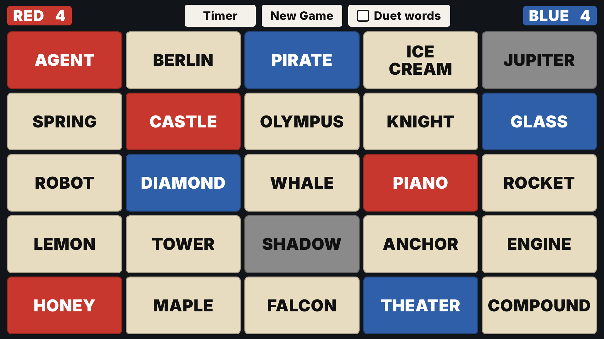

# Codenames TV Board

A single-file web page that puts a Codenames word grid on a TV, so the whole room can see the board during a party game.

The page only shows words and tracks colors. It does **not** assign or hide team colors: spymasters use the key cards from the physical board game, and someone at the TV marks each card as it is guessed.

## Quick start

1. Download [`index.html`](index.html).
2. Open it in any modern browser on the TV, laptop or tablet.
3. Go full screen (F11 on most browsers) so the board fills the display.

There is nothing to install or build, and the page makes no network requests while it runs. It works offline once the file is on the device.

To host it, serve `index.html` from any static web host, such as GitHub Pages.

## How to play

- **Mark a card:** click or tap a card to cycle its color: beige, red, blue, grey, black, then back to beige. Cycling also fixes a mis-click, so there is no separate undo.
- **Scores:** the RED and BLUE counts in the top bar show how many cards are currently marked for each team.
- **New Game:** asks for confirmation, then deals 25 new words with every card reset to beige.
- **Timer:** starts a 60 second countdown. Press it again to stop. The last 10 seconds pulse red, and at zero it shows "TIME!", flashes and beeps.
- **Duet words:** when checked, the *next* New Game deals from the Codenames Duet word list. Changing it never alters the board in play.

## TV remote and keyboard

| Key | Action |
|---|---|
| Arrow keys | Move between cards and the top-bar controls |
| Enter or Space | Cycle the focused card's color, or press the focused control |
| Escape | Close the New Game dialog without changing anything |

The focused item has a thick yellow outline. No feature needs a mouse hover.

## Saving

The current words, card colors and the Duet setting are saved in the browser's `localStorage`, so an accidental refresh keeps the game. The timer is not saved and returns to idle on refresh. If the browser blocks storage (for example in a private window), the board still works but won't survive a refresh.

## Screen sizes

The layout fills the screen with no scrolling. It is designed for 1920x1080 TVs and also fits 4K TVs, laptops, and iPads in landscape or portrait.

- Every word on the board uses one font size, set by the longest word dealt, so nothing overflows.
- Multi-word clues ("ICE CREAM", "JOAN OF ARC") wrap onto two evenly split lines.
- The top bar scales by screen width as well as height, so it fits narrower 4:3 tablet screens.

## Word lists

Both lists are embedded in `index.html` as JavaScript arrays, trimmed and de-duplicated:

| List | Entries | Source |
|---|---|---|
| Original (`WORDS`) | 400 | [Gullesnuffs/Codenames](https://github.com/Gullesnuffs/Codenames) `wordlist-eng.txt` (that repository has no license file) |
| Duet (`DUET_WORDS`) | 390 | [koosvary/codenames](https://github.com/koosvary/codenames) `word_lists/duet.txt` (MIT License, Copyright (c) 2018 Lachlan Meyer) |

The two lists share no words.

## Development

Everything lives in `index.html`: inline CSS, inline JavaScript, no frameworks and no external dependencies. Edit the file and reload the browser to see changes.

## Disclaimer

Codenames is a board game by Vlaada Chvátil, published by Czech Games Edition. This is an unofficial fan-made companion with no affiliation to the publisher, and it is meant to be used alongside a copy of the game.
